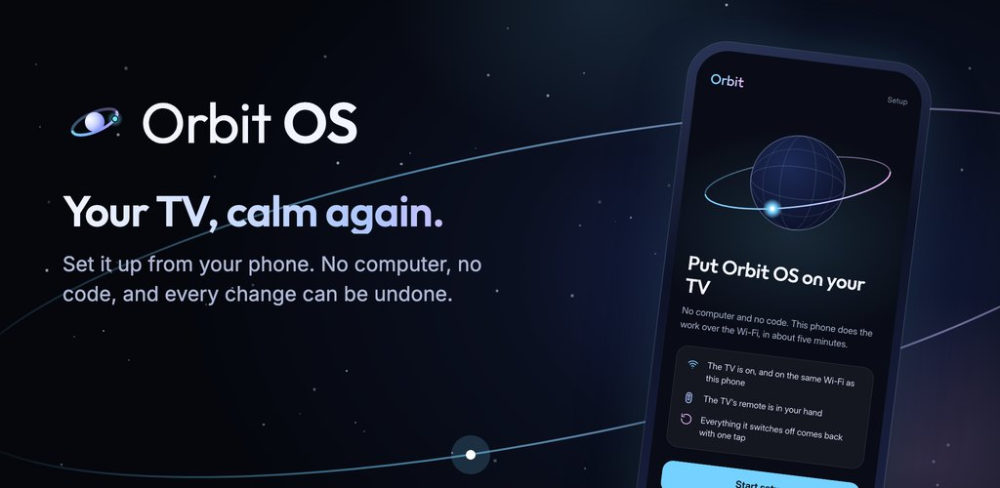

<h1 align="center">Orbit OS</h1>

<b>Your TV, calm again.</b> Set up your Android TV from your phone: a calm home screen, a globe remote, and every change can be undone with one tap.

  <a href="https://shivamj56.github.io/orbit-os-site/">Website</a> ·
  <a href="https://play.google.com/store/apps/details?id=dev.shiv.orbit">Google Play</a> ·
  <a href="https://shivamj56.github.io/orbit-os-site/privacy.html">Privacy</a> ·
  <a href="https://github.com/shivamj56/orbit-os-site/issues">Issues</a>

## What Orbit does

- **No computer, no code.** The Orbit phone app finds your TV on your Wi-Fi, asks five plain questions, shows the whole plan, then sets the TV up in about five minutes.
- **A remote that feels new.** Roll the globe to move, tap for OK, hold for Home, or use a classic D-pad. Works at home, and from anywhere once you sign in with Google.
- **Your choices.** Keep the apps you use and switch off the preinstalled ones you don't. Nothing is deleted.
- **Undo everything.** Orbit writes down every change before it makes it; one tap brings back the TV's own home screen, apps and settings.
- **Private by design.** No ads, no analytics, no trackers. Backups go to your own Google Drive.

Tested on the Xiaomi TV A Pro (MiTV-AXFU0). More TVs are being added.

## Help make Orbit better

This repository is Orbit's public home: the website, the privacy policy, and the place to talk.

- **Tried Orbit on your TV?** Open a [TV report](https://github.com/shivamj56/orbit-os-site/issues/new?template=tv-report.yml) with the model and what worked.
- **Found a problem?** Open a [bug report](https://github.com/shivamj56/orbit-os-site/issues/new?template=bug.yml).
- **Have an idea?** Open an [idea](https://github.com/shivamj56/orbit-os-site/issues/new?template=idea.yml).

If Orbit made your TV nicer, a ⭐ helps other people find it.

## About

Orbit OS is made by **Shivam Anil Jha**. Orbit's source code is private; this repository holds only the public website and documents. Copyright © 2026 Shivam Anil Jha. All rights reserved.
